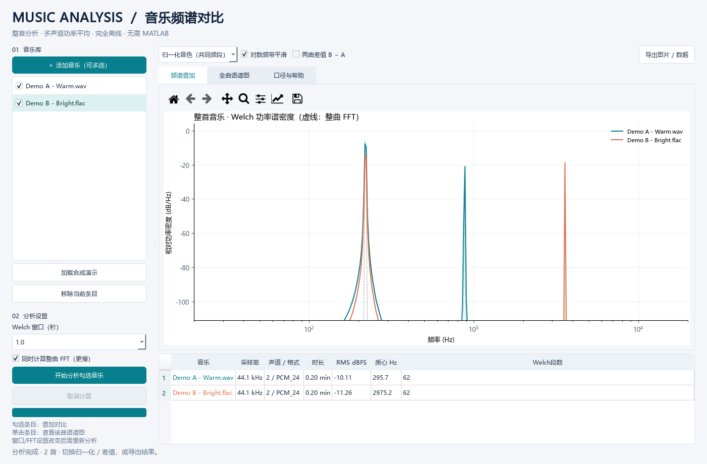

# Music Analysis · 音乐频谱对比

**独立 Windows 11 x64 桌面应用。最终用户无需安装 MATLAB、Python 或 conda。**

读取整首音乐、比较不同音乐的频谱与音色；计算在后台执行，不在分析过程中反复弹窗。
项目从 MATLAB 原型审查重构而来，保留了一个纯过程式 MATLAB 数值参考，但成品不依赖 MATLAB Runtime。



## 下载与安装

从 [Releases](https://github.com/Mengyaoxu666/music-analysis/releases/latest) 下载：

- **安装版** `MusicAnalysis-1.0.0-Windows-x64-Setup.exe`：双击，按当前用户安装，提供开始菜单快捷方式和卸载器，不需要管理员权限。
- **便携版** `MusicAnalysis-1.0.0-Windows-x64-portable.zip`：完整解压，双击其中的 `MusicAnalysis.exe`。不要单独移动 EXE，必须保留 `_internal` 文件夹。
- `SHA256SUMS.txt`：下载校验值。

支持 Windows 11 x64（Intel/AMD），不承诺原生 ARM64 支持。
安装包尚未进行商业代码签名，Windows SmartScreen 可能提示未知发布者。
请核对来源和 SHA256；不要为运行本程序关闭系统防护。

## 使用

1. 点击 **添加音乐**，可多选本地文件；或点击 **加载合成演示**。
2. 勾选要对比的音乐，点击 **开始分析**。默认分析整首，不选取“最高能量片段”。
3. **绝对电平**：查看真实数字功率密度；**归一化音色**：排除音量差，比较频谱形状。
4. 恰好勾选两首时，启用 **两曲差值 B−A**，B 为列表中靠后的歌曲。
5. 单击音乐条目，切换 **全曲语谱图** 查看；色标固定，便于跨曲比较。
6. 点击 **导出图片 / 数据**，选择保存目录。输出每首歌的 CSV/报告和总对比图片。

支持 **WAV、MP3、FLAC、OGG、AIFF**，自动读取采样率、声道和编码格式。
有损编码显示编码类型，不把解码字长冒充原始位深。**AAC/M4A 暂不支持**，请先转为 WAV/FLAC。

### 计算设置

- Welch 窗口：0.25 / 0.5 / 1 / 2 秒；窗口越长，频带越窄，计算量也上升。
- 默认 75% 重叠、周期 Hann 窗；最后一个窗口补足尾部覆盖，不丢尾段。
- 可选 **同时计算整曲 FFT**：显示为同色虚线；计算更慢、内存更高。
  整文件分配前进行保守 1.5 GiB 估算检查，超限给出提示。
- 显示平滑在计算之后做对数频带**功率均值**，不改变原始 Welch CSV。
- 支持进度和取消；单个文件损坏不会丢掉其他已完成的结果。
- 切换显示模式只用缓存，无需重新读音频。改变窗口/FFT设置后需再次分析。

## 数值口径：不要把不同量混为一谈

- PSD：`mean_channels(abs(FFT(x*w))²) / (fs * sum(w²))`，单边谱内部频点乘 2。
- PSD 单位 **FS²/Hz**，纵轴是 `10log10(PSD / (1 FS²/Hz))`，**不是 SPL 声压级**。
- RMS dBFS 以样本幅值 1 为参考：满幅正弦 RMS 为 **−3.01 dBFS**。不是 LUFS 响度。
- 归一化按所有勾选音乐**共有频段**（20 Hz 至最小 Nyquist/20 kHz）的积分功率缩放。
  这适合比较音色，不是感知响度匹配或音质评分。
- 所有声道**先平方后平均**；反相立体声不会被误判为静音。
- 全曲 Welch 和整曲 FFT 的窗带宽/方差不同；补零只加密频率网格。
  **谱峰相近本身不是正确性验证。** 本项目通过独立 SciPy Welch、积分功率和已知增益回归验证。
- 全曲 STFT 所有窗口都参与计算，随后将线性功率按时间平均到最多 720 列用于展示。
  因而5分钟以上音频不会随时长无限累积语谱图内存，但很短的瞬态可能因显示平均变淡。

## 输出与隐私

```text
所选导出目录/
├─ comparison.png       当前频谱对比/差值图
├─ spectrogram.png      当前选中歌曲的语谱图
├─ comparison.csv       各曲参数与指标
├─ 01_歌曲名/
│  ├─ welch_psd.csv       未降采样的Welch PSD
│  ├─ full_fft_display.csv 可选：整曲FFT的对数频带均值
│  └─ report.json         参数、指标、单位说明
└─ 02_歌曲名/             重名文件也有独立编号，不覆盖
```

- 程序完全离线，不上传音频，不包含遥测；不读取音频标签、封面或账户信息。
- 来源路径只在运行进程内使用；导出只含文件名，不含源绝对路径。
- 导出会包含用户选择的**音乐文件名**，对外分享前请自行核对。
- 仓库截图/测试均为数学合成信号，仓库与发布包不包含私人音乐、真实歌曲名或本地路径。

## 开发、测试与打包（仅开发者需要）

经确认的开发环境名为 `music-analysis`：

```powershell
conda env create -f environment.yml
conda run -n music-analysis python main.py
conda run -n music-analysis python -m ruff check .
conda run -n music-analysis python -m pytest -q
conda run -n music-analysis python main.py --smoke-test local/smoke
conda run -n music-analysis python scripts/build_windows.py
```

在 Windows 上用 Inno Setup 6.4.3+ 编译 `installer/windows.iss` 生成安装器。
依赖直接版本固定在 `requirements*.txt`，测试通过的完整解析版本在 `requirements-lock.txt`。
GUI 由内置 Qt 控件与函数回调组织，数值核心为过程式函数，无自定义类。

目录：`music_analysis/analysis.py` 数值核心；`gui.py` 界面；`export.py` 导出；
`tests/` 可复现回归；`reference/welch_reference.m` MATLAB R2026a 数值参考；
`docs/REVIEW.md` 原实现问题与修复；`docs/VALIDATION.md` 本次验收记录。

## 已知边界

- 当前为 Windows 11 x64 首个版本；未在所有声卡/显卡/语言包或全新虚拟机上做兼容矩阵测试。
- 分析不需要声卡，也不播放音频。最小界面约 1000×700 逻辑像素。
- 可选整曲 FFT 开始后，取消会在本次 FFT 返回时生效；默认分段分析可更及时取消。
- 代码暂未指定项目级再分发许可证；公开仓库不代表放弃著作权。
  随包第三方许可证及共享库替换权利不受此项影响，详见 [THIRD_PARTY_NOTICES.md](THIRD_PARTY_NOTICES.md)。
